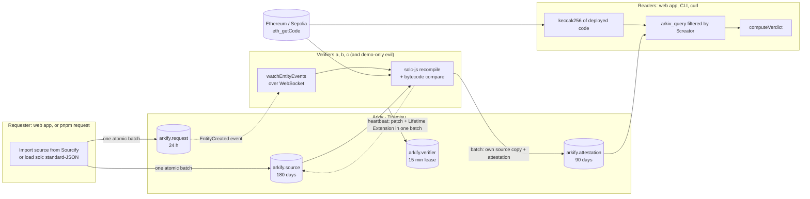

# Arkify

**Proof that a smart contract's source is what it claims to be, signed by independent verifiers on
Arkiv and readable by anyone without our servers.**

Arkify verifiers recompile a contract's published Solidity source with the official compiler and
compare the result with the bytecode deployed on Ethereum. Each one writes its answer to Arkiv, the
Web3 database, from its own wallet. Readers count only the answers signed by accounts they choose
to trust. Arkiv records who signed each answer, and nobody can change that afterwards.

- **Live app:** _TODO: add the public URL after deployment_
- **Demo video (≤ 3 min):** _TODO_
- **Data contract:** [`arkiv/schema.md`](arkiv/schema.md) · **Friction log:** [`arkiv/friction.md`](arkiv/friction.md)
- **Tracks:** Security (primary), Censorship Resistance
- **Network:** Arkiv Tiramisu testnet (chain ID `7738577`), `@arkiv-network/sdk@0.8.1`

---

## The problem

When a block explorer shows "verified source" next to a contract, people act on it. A user signs an
`approve()` because the source they read looks harmless. An auditor reviews that source and not the
bytecode. Wallets and dashboards copy the badge. In every case the badge comes from **one
operator's database**, and that operator can be wrong, compromised, pressured into removing an
entry, or simply go offline.

We have lived this. Arkify grew out of [Sorofy](https://github.com/erdemasik001/Sorofy), our earlier
build verifier for Soroban. There, results lived in one operator's SQLite file. The operator could
delete a result, edit it, or print a "verified" badge that no compiler ever produced. Nothing a
reader saw proved otherwise. Stellar Lab removed its source tab after a malicious WASM was shown
with a "build verified" badge. A single trusted badge is the weak point.

## Who is harmed, and what changes (Why these pillars)

### Security: trust comes from `$creator`, not from a field anyone can write

- **Harmed today:** the person who signs a transaction against a contract whose shown source is not
  the code that runs. Also the auditor who reviews the wrong file, and the explorer that vouches for
  it.
- **What Arkify changes:** an attestation counts only if its **on-chain `$creator`** is in the
  reader's trusted list. The filter runs on the Arkiv node (`$creator = addr(…) OR …`), so a
  forged attestation from any other account is never returned for counting. It is shown separately
  as untrusted. The demo includes a deliberately dishonest verifier (`evil`) that attests
  `full_match` to everything:
  - with default trust, its claims sit in the "From accounts you do not trust" section and change nothing;
  - if a user trusts it, the contract turns **Disputed**, and the page shows exactly who said what.
- **Scoped to the code that runs:** every attestation carries `code_hash`, the keccak256 of the
  runtime bytecode the verifier read. A lookup always uses the hash of the code deployed *now*, so
  an old "verified" never carries over to new code at the same address.
- **Independent verifiers:** a contract is **Verified** only when at least two trusted verifiers
  (configurable) each compiled the same source and matched. If a trusted verifier disagrees with
  another about the same source, the contract is **Disputed**. Arkify never collapses that into a
  green tick.

### Censorship Resistance: the answer outlives the site

- **Harmed today:** anyone who depends on a verification result held by a party that can take it
  down. That includes the operator of Arkify.
- **What Arkify changes:** the web app is static files with no backend. Its content security policy
  lets it talk only to Arkiv, two public Ethereum RPCs and Sourcify. Every contract page prints the
  exact Arkiv query and the equivalent `curl` call that produced it. If this site, our verifiers and
  our GitHub all disappeared, anyone could still read every attestation with one JSON-RPC call (see
  [Read it yourself](#read-it-yourself-exact-queries)). A command-line client
  ([`packages/cli`](packages/cli/src/main.ts)) gives the same verdict from a terminal.
- **Nobody needs our permission to keep data alive:** requests, sources and attestations are
  created with `permissionlessExtension`. Anyone who relies on an attestation can extend its life
  from the web app ("Keep alive") without being able to change it.

## Why Arkiv

| If we used… | What breaks for Arkify |
|---|---|
| **Postgres or any operator-run database** | Whoever runs it can edit, delete or invent rows. A `signed_by` column is just a value the operator writes. This is exactly Sorofy's weakness. |
| **IPFS** | It proves a blob's integrity, not who published it or when. There is no way to ask "attestations about this address and code hash, signed by these accounts". That needs an indexer, which is a server again. It also has no lifetimes: a dead verifier's registration would stay forever unless someone cleans it up. |
| **A subgraph** | It needs a contract of ours to emit events and an indexer someone runs. Readers query the indexer's API, not the chain. That is one more party that can lag, filter or disappear. |
| **Our own API** | It is the single point of censorship and trust that Arkify exists to remove. |

What Arkify relies on and would not have without Arkiv:

1. **`$creator` set by the chain and filterable on the node.** It is the whole trust model. A
   verifier's identity is the account that created the entity, and the node returns only entities
   from accounts the reader trusts.
2. **Typed, queryable attributes with no server of ours in between.** A static page or a `curl`
   asks for `chain_id`, `address`, `code_hash` and `$creator`, and gets the answer.
3. **Entity Expiration as product logic.** A verifier's registration is a 15-minute lease. A dead
   worker drops out of the registry by itself, so the app never shows a stale "online" and no
   clean-up job exists.
4. **Creation flags.** `readonly` means a verifier cannot quietly rewrite a published result.
   `permissionlessExtension` means the community, not us, decides how long a result stays.
5. **Atomic batches.** A request and its source land together, or not at all. A verifier's copy of
   a source and the attestation that points at it also land together.

**Deliberately kept off Arkiv:** compilation and the solc binaries (computation that any verifier
repeats from the source), the deployed bytecode (Ethereum is its canonical store; we keep only its
hash), private keys and access keys, a verifier's work queue, and each user's trusted list (a local
preference, stored in the browser or passed as a CLI flag).

## How it works



1. **Request.** Someone picks a contract and a candidate source (imported from Sourcify or a solc
   standard-JSON file). One transaction creates the `arkify.source` (brotli-compressed,
   content-addressed by `source_hash`) and the `arkify.request` that points at it.
2. **Verify.** Each verifier hears the request from Arkiv's WebSocket event stream. It downloads the
   exact solc release from `binaries.soliditylang.org` and checks its SHA-256 against the official
   list. It then compiles in an isolated process with a memory ceiling, and compares the result
   with the runtime bytecode on chain. It ignores immutables, and separates the metadata hash to
   tell `full_match` from `partial_match`.
3. **Attest.** The verifier writes an `arkify.attestation` from its own wallet. For a match it also
   keeps its **own copy** of the source in the same batch, so the source stays readable even if the
   submitter deletes theirs. If asked again about the same code and source, it performs a Lifetime
   Extension on its existing attestation instead of writing a duplicate.
4. **Read.** The web app and the CLI hash the deployed code, ask Arkiv for attestations about that
   code signed by the trusted accounts, and run the same pure
   [`computeVerdict`](packages/core/src/verdict.ts): Verified, Weakly verified, Disputed, Mismatch
   or Unverified.

## How Arkify uses Arkiv

Each feature below changes something the user sees. The full data contract, with every attribute,
lifetime, flag and query, is in [`arkiv/schema.md`](arkiv/schema.md).

| Feature | How and why | What the user sees | Code |
|---|---|---|---|
| **`$creator` trust filter** | The verdict query ends with `($creator = addr(a) OR $creator = addr(b) …)`. The complement `NOT (…)` fetches everyone else. It runs on the node, so untrusted entities cannot crowd trusted ones out of a page. `createdBy()` takes one address, hence the `OR` ([F-004](arkiv/friction.md)). | The verdict counts only accounts you trust. Every row shows the signer's address, linked to the explorer. Untrusted claims appear in their own section with a "Trust" button. | [`queries.ts`](packages/core/src/queries.ts#L22-L57), [`Contract.tsx`](apps/web/src/pages/Contract.tsx#L174) |
| **Typed attributes vs payload** | Everything filtered on is a typed attribute: `chain_id`, `address`, `code_hash`, `source_hash`, `verdict`. Timestamps (`verified_at`, `last_beat`) are `u64`, so they can be range-filtered. Compiler output details and the compressed source are payload. | A lookup by chain and address answers in a handful of queries. The home page shows "attestations in the last 7 days" from a `verified_at` range. | [`records.ts`](packages/core/src/records.ts), [`schema.ts`](packages/core/src/schema.ts) |
| **Compound queries and cursor pagination** | `AND` / `OR` / `NOT`, ranges on `u64`, and `.createdBy(self)` for a verifier to find its own records. Pages of 200 are read with the cursor and sorted on the client (the node has no ordering). | Complete lists no matter how many entities exist. A restarted verifier resumes from what it already wrote on Arkiv instead of redoing it. | [`client.ts`](packages/core/src/client.ts#L36-L52), [`verifier.ts`](packages/verifier/src/verifier.ts#L323-L337) |
| **Entity Expiration per type** | Verifier lease 15 min · request 24 h · source 180 days · attestation 90 days · failed attestation 24 h. Each follows product logic (lifetime does not change the fee, [W-013](arkiv/friction.md)). | Offline verifiers vanish from the registry on their own. A request that nobody answers does not linger, and its card says when it expires. An attestation's remaining life shows on hover. | [`schema.ts`](packages/core/src/schema.ts#L42-L56) |
| **Lifetime Extension as a lease** | Every 5 minutes a verifier sends one batch that patches `last_beat` and extends its registration back to 15 minutes. Re-checking the same code and source extends the existing attestation. | The Verifiers page shows online/offline and the last heartbeat. It updates from `ExpiryExtended` events without polling. | [`verifier.ts`](packages/verifier/src/verifier.ts#L144-L158), [`verifier.ts`](packages/verifier/src/verifier.ts#L265-L272), [`Verifiers.tsx`](apps/web/src/pages/Verifiers.tsx#L28-L30) |
| **Creation flags** | Requests, sources and attestations are `readonly` + `permissionlessExtension`. The verifier registration has neither, because it is patched on every beat and only its owner should keep it alive. | A published result can never be edited. Any visitor with a wallet can press "Keep alive" on an attestation, source or request they rely on. | [`schema.ts`](packages/core/src/schema.ts#L58-L66), [`KeepAlive.tsx`](apps/web/src/components/KeepAlive.tsx) |
| **Atomic batches + `predictEntityKeys`** | Source + request: the source key is predicted and stored in the request's `source_key`. A verifier's source copy + attestation are written the same way. The heartbeat is a patch + extension in one batch. | A request never points at a missing source. A "Verified" result always links to a readable source copy held by the verifier. | [`client.ts`](packages/core/src/client.ts#L103-L145), [`verifier.ts`](packages/verifier/src/verifier.ts#L282-L313) |
| **WebSocket entity events** | `watchEntityEvents` over a WebSocket transport, no `fromBlock`. Events carry no attributes ([F-005](arkiv/friction.md)), so [`mayBe`](packages/core/src/events.ts#L27-L38) uses each type's fixed lifetime and flags to drop foreign creates before any read. The connection is owned and rebuilt with backoff ([F-015](arkiv/friction.md)). | Verifiers start work as soon as a request lands, with no polling interval. A contract page and the home feed update without a refresh. | [`live.ts`](packages/core/src/live.ts), [`Contract.tsx`](apps/web/src/pages/Contract.tsx#L102-L123) |
| **Direct JSON-RPC** | Every contract page prints its `arkiv_query` and a `curl` that reproduces it. | "Verify this without us": the reader can check the page against the chain without trusting the page. | [`Contract.tsx`](apps/web/src/pages/Contract.tsx#L402-L430), [`arkiv.ts`](apps/web/src/lib/arkiv.ts#L52) |

## Try it

### In the live app (no wallet needed)

1. Open the live app and click **ENS registry** under the search box. This is the ENS registry on
   Sepolia, `0x00000000000C2E074eC69A0dFb2997BA6C7d2e1e`.
2. You see **Verified**: three trusted verifiers compiled `ENSRegistryWithFallback` and got exactly
   the deployed code, metadata hash included. A tampered copy of the source (one token changed:
   `owner == msg.sender` → `owner == tx.origin`) was checked too, and all three said **Mismatch**.
3. Scroll to **From accounts you do not trust**. The demo-only `evil` verifier claimed `full_match`
   for both sources. It is shown and not counted.
4. Press **Trust** on `evil`, or toggle it on the **Verifiers** page. The contract turns **Disputed**,
   because trusted verifiers now disagree about the tampered source. Untrust it to go back.
5. Open **Verify this without us** at the bottom. Copy the `curl` and run it: the same attestations
   come straight from Arkiv.

### Request a check (needs a wallet)

Open **Request a check**, enter a Sepolia contract that Sourcify knows, and press **Import from
Sourcify**. Connect a wallet: the app adds Tiramisu with `wallet_addEthereumChain`. You need a
little testnet GLM from the [Hub faucet](https://hub.arkiv.network/faucet). Then sign one
transaction. The live verifiers answer on the contract page as their attestations arrive.

## Read it yourself (exact queries)

No SDK, no key, no Arkify server: these go straight to the public Tiramisu RPC. Queries are shown
exactly as sent to `arkiv_query`. [`arkiv/schema.md`](arkiv/schema.md#queries-the-app-runs) lists
every query the app runs.

**The ENS registry verdict, as the web app computes it** (attestations about the deployed code,
signed by the three team verifiers):

```bash
curl -s https://rpc.tiramisu.db-chain.testnet.arkiv.network -H 'content-type: application/json' --data @- <<'JSON'
{"jsonrpc":"2.0","id":1,"method":"arkiv_query","params":["type = str('arkify.attestation') AND schema_version = i32(1) AND chain_id = u64(11155111) AND address = addr(0x00000000000C2E074eC69A0dFb2997BA6C7d2e1e) AND code_hash = bytes32(0x8ea75f170914f04bc7c03e47eac3d7f5763f40fd5337cad69011bc7245fcf4a0) AND ($creator = addr(0xB5F160b92c066f9613fb05227744c604683cB590) OR $creator = addr(0xcF73f570D2F15C5A814D0D9D63164c4f99012E0E) OR $creator = addr(0x86C783d97F9B1734ceAD7ac3Aeb12Bc5bC9DAe5C))",{"select":{"key":true,"creator":true,"expiresAt":true,"attributes":true}}]}
JSON
```

Group the results by `source_hash`. A source is verified when at least 2 different creators say
`full_match` or `partial_match` and none says `mismatch`.

**The same contract, from everyone else** (the untrusted section; here, the `evil` verifier):

```bash
curl -s https://rpc.tiramisu.db-chain.testnet.arkiv.network -H 'content-type: application/json' --data @- <<'JSON'
{"jsonrpc":"2.0","id":1,"method":"arkiv_query","params":["type = str('arkify.attestation') AND schema_version = i32(1) AND chain_id = u64(11155111) AND address = addr(0x00000000000C2E074eC69A0dFb2997BA6C7d2e1e) AND code_hash = bytes32(0x8ea75f170914f04bc7c03e47eac3d7f5763f40fd5337cad69011bc7245fcf4a0) AND NOT ($creator = addr(0xB5F160b92c066f9613fb05227744c604683cB590) OR $creator = addr(0xcF73f570D2F15C5A814D0D9D63164c4f99012E0E) OR $creator = addr(0x86C783d97F9B1734ceAD7ac3Aeb12Bc5bC9DAe5C))",{"select":{"key":true,"creator":true,"expiresAt":true,"attributes":true}}]}
JSON
```

**The deployed code it is scoped to** (its keccak256 is the `code_hash` above):

```bash
curl -s https://ethereum-sepolia-rpc.publicnode.com -H 'content-type: application/json' --data '{"jsonrpc":"2.0","id":1,"method":"eth_getCode","params":["0x00000000000C2E074eC69A0dFb2997BA6C7d2e1e","latest"]}'
```

**Every live Arkify attestation, and the verifiers holding a live lease:**

```bash
curl -s https://rpc.tiramisu.db-chain.testnet.arkiv.network -H 'content-type: application/json' --data '{"jsonrpc":"2.0","id":1,"method":"arkiv_query","params":["type = str('"'"'arkify.attestation'"'"') AND schema_version = i32(1)",{"select":{"key":true,"creator":true,"expiresAt":true,"attributes":true}}]}'
curl -s https://rpc.tiramisu.db-chain.testnet.arkiv.network -H 'content-type: application/json' --data '{"jsonrpc":"2.0","id":1,"method":"arkiv_query","params":["type = str('"'"'arkify.verifier'"'"') AND schema_version = i32(1)",{"select":{"key":true,"creator":true,"expiresAt":true,"attributes":true}}]}'
```

**From a terminal, with the same verdict logic as the web app:**

```bash
pnpm arkify check 11155111 0x00000000000C2E074eC69A0dFb2997BA6C7d2e1e
pnpm arkify check 11155111 0x00000000000C2E074eC69A0dFb2997BA6C7d2e1e --trusted 0xB5F160b92c066f9613fb05227744c604683cB590 --threshold 1 --json
```

The CLI exits with status 0 for verified, 1 for not verified, 2 for disputed and 3 if it could not
answer.

The public RPC allows about 100 `arkiv_query` calls per hour per address without an access key
([F-013](arkiv/friction.md)). If you hit it, the web app tells you how long to wait.

## Run it locally

Requirements: Node.js 22 or newer and pnpm 12.

```bash
git clone https://github.com/erdemasik001/arkify.git
cd arkify
pnpm install
```

**Read only (no wallet, no keys):**

```bash
pnpm web                  # the web app on http://localhost:5173
pnpm arkify check 11155111 0x00000000000C2E074eC69A0dFb2997BA6C7d2e1e
pnpm test                 # unit tests, offline
pnpm typecheck
```

**Write to Arkiv with your own wallets.** Keys are generated into `.env`, which is gitignored, and
are never printed:

```bash
cp .env.example .env
pnpm gen-wallets          # requester, verifier-a/b/c and the demo-only evil wallet; prints addresses only
```

Claim testnet GLM at the [Hub faucet](https://hub.arkiv.network/faucet) and send it to the
requester address. Then spread it to the other wallets:

```bash
pnpm fund
```

**The whole demo in one command.** It starts three honest verifiers and the dishonest one,
requests a check of the ENS registry against its true source and against a tampered copy, waits for
the attestations, reads them back from Arkiv and checks the verdicts:

```bash
pnpm e2e
```

Other entry points:

```bash
pnpm request 11155111 0x00000000000C2E074eC69A0dFb2997BA6C7d2e1e   # request a check, source from Sourcify
pnpm verify 11155111 0xcA11bde05977b3631167028862bE2a173976CA11    # run the engine once, without Arkiv
pnpm smoke                                                          # write one entity of each type, run every query
pnpm spike                                                          # the Phase 0 measurements in arkiv/friction.md
```

### Run a verifier

Anyone can run one. A verifier is a funded Tiramisu wallet and this process:

```bash
pnpm verifier --name my-verifier --key-env VERIFIER_A_PRIVATE_KEY
```

The team fleet (three honest verifiers and `evil`) runs from the [`Dockerfile`](Dockerfile) and
[`docker-compose.yml`](docker-compose.yml), configured from `.env`:

```bash
docker compose up --build -d
```

A verifier that runs all day should use an access key from the
[Hub](https://hub.arkiv.network/access-keys). Copy it, then run `pnpm set-access-key`, which reads it
from the clipboard into `.env`. The key stays out of the web app, which runs on the anonymous
budget.

For others to count your attestations, users add your address to their trusted list on the
Verifiers page, or pass it with `--trusted`.

## On-chain evidence

These wallets create Arkify's entities on Tiramisu. Each link opens the explorer, where every
creation transaction is listed.

| Role | Address | Creates |
|---|---|---|
| Requester (demo) | [`0xfEBd2309E6C92c1F924A42Dc78d0E8D95Ea666C0`](https://tiramisu.explorer.arkiv.network/address/0xfEBd2309E6C92c1F924A42Dc78d0E8D95Ea666C0) | `arkify.request` and `arkify.source` from `pnpm e2e` / `pnpm request`; Phase 0 spike entities |
| verifier-a | [`0xB5F160b92c066f9613fb05227744c604683cB590`](https://tiramisu.explorer.arkiv.network/address/0xB5F160b92c066f9613fb05227744c604683cB590) | `arkify.verifier`, `arkify.attestation`, `arkify.source` (own copies); spike entities |
| verifier-b | [`0xcF73f570D2F15C5A814D0D9D63164c4f99012E0E`](https://tiramisu.explorer.arkiv.network/address/0xcF73f570D2F15C5A814D0D9D63164c4f99012E0E) | `arkify.verifier`, `arkify.attestation`, `arkify.source` |
| verifier-c | [`0x86C783d97F9B1734ceAD7ac3Aeb12Bc5bC9DAe5C`](https://tiramisu.explorer.arkiv.network/address/0x86C783d97F9B1734ceAD7ac3Aeb12Bc5bC9DAe5C) | `arkify.verifier`, `arkify.attestation`, `arkify.source` |
| evil (demo only, dishonest) | [`0x0288268E6dD0F64F97dE427527f0EADa636c33C3`](https://tiramisu.explorer.arkiv.network/address/0x0288268E6dD0F64F97dE427527f0EADa636c33C3) | `arkify.verifier`, `arkify.attestation` (always `full_match`, nothing compiled) |

Requests made from the web app are signed by the visitor's own wallet, so they show up under
those addresses.

**If entities expire before judging:** attestations live 90 days and sources 180 days, so the demo
data outlives judging. Verifier registrations are 15-minute leases by design, and requests live 24
hours. Their creation transactions stay on the explorer under the addresses above.
[`arkiv/spike-run.json`](arkiv/spike-run.json) records the transaction hash of every Phase 0
measurement.

## Repository layout

| Path | What it is |
|---|---|
| [`packages/core`](packages/core/src) | The data contract in code: entity types, encode/decode, query builders, `computeVerdict`, the live WebSocket subscription. Shared by everything below. |
| [`packages/engine`](packages/engine/src) | The EVM verification engine: fetch deployed code, download and check the solc release, compile, compare. |
| [`packages/verifier`](packages/verifier/src) | The worker: lease heartbeat, request events and catch-up scans, attestation writes. |
| [`packages/cli`](packages/cli/src) | `arkify check`: a verdict from a terminal. |
| [`apps/web`](apps/web/src) | The static web app (React + Vite). Reads Arkiv and Ethereum from the browser. |
| [`scripts`](scripts) | Wallet generation, funding, the Phase 0 spike, smoke and end-to-end runs. |
| [`arkiv`](arkiv) | `schema.md`, `friction.md`, and the spike's raw output. |

## Limits and honest caveats

- **The `evil` verifier is demo-only.** It exists to show that trust filtering works, and its
  registration says so.
- **The default trusted list is the three team verifiers.** It is only a default. Users replace it
  on the Verifiers page or with `--trusted`, and the choice never leaves their machine.
- **Sources are public.** They are stored on Arkiv byte for byte. Submit only sources without
  personal data. The demo uses the ENS registry because its source carries no author names or
  e-mail addresses.
- **Scope:** Solidity on Ethereum mainnet and Sepolia. Proxies are not resolved to their
  implementation, and Vyper is not supported. A source bundle must fit in 120 KiB after brotli
  ([F-011](arkiv/friction.md)).
- **Spam:** anyone can write a request. Verifiers answer at most 30 requests per requesting account
  per hour.

## Pre-existing work

- **Idea only, no code:** Arkify is a new implementation of the idea behind
  [Sorofy](https://github.com/erdemasik001/Sorofy), our earlier Soroban build verifier. Baseline:
  [`d0dd356`](https://github.com/erdemasik001/Sorofy/commit/d0dd356652de1af2540c79d2301ad4902cadbe6a)
  (20 September 2026). No Sorofy code, schema or component is reused. Everything in this
  repository, including the whole Arkiv integration, was written between 9 and 18 October 2026.
- **Third-party libraries:** `@arkiv-network/sdk`, `viem`, solc-js (official compiler builds,
  downloaded at run time from `binaries.soliditylang.org`), React, Vite, `brotli-wasm`, Fontsource
  fonts, Vitest. The Sourcify API is used to import candidate sources.
- **AI assistance:** built with Claude Code.

## License

[MIT](LICENSE)
